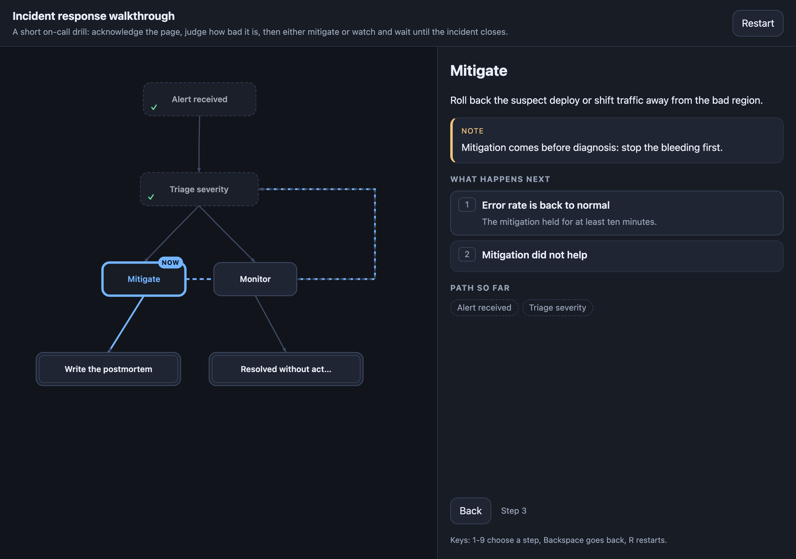

# walkforge

[](https://github.com/oh-namgyu/walkforge/actions/workflows/ci.yml)
[](LICENSE)

> **한글 요약**
>
> 상태 기계 명세(JSON) 하나를 넣으면, 독자가 한 단계씩 눌러가며
> 따라갈 수 있는 **단일 HTML 워크스루 페이지**를 만들어 줍니다. 왼쪽은 현재 위치가
> 표시되는 그래프, 오른쪽은 지금 상황 설명과 선택지 버튼입니다. 표준 라이브러리만
> 쓰고 빌드 단계가 없으며, 생성된 페이지는 네트워크 요청을 전혀 하지 않습니다.
> LLM으로 초안을 만드는 `new`/`revise` 명령은 선택 사항이고 API 키가 있을 때만
> 동작합니다.

Turn a state-machine spec into a self-contained interactive walkthrough page.

```bash
python3 -m walkforge init flow.json     # start from a working example
python3 -m walkforge render flow.json   # -> flow.html, open it in a browser
```

## Why

A flow chart shows you the whole process at once and lets you follow none of
it. You read a Mermaid diagram the way you read a map: everything is visible,
nothing is happening. The alternative — an *explorable explanation*, where the
reader clicks through a real path and sees where they are — usually means
hand-writing a page with bespoke JavaScript for one document.

walkforge is the middle: you describe the process once, as states and the
choices between them, and get the interactive version. The spec is small
enough to write by hand or to keep in a repository next to the runbook it
documents.



The page follows the reader's system theme; here is the same walkthrough in
light mode: [`docs/walkforge-light.png`](docs/walkforge-light.png).

## Install

Nothing to install for the offline commands — clone and run:

```bash
git clone https://github.com/oh-namgyu/walkforge
cd walkforge
python3 -m walkforge init flow.json
```

Or install the `walkforge` command:

```bash
pipx install git+https://github.com/oh-namgyu/walkforge
walkforge init flow.json
```

Python 3.9 or newer. The base install has no dependencies beyond the standard
library; `pipx install "git+https://github.com/oh-namgyu/walkforge#egg=walkforge[llm]"`
adds the optional `anthropic` SDK used only by `new` and `revise`.

## Quickstart (no API key needed)

1. `python3 -m walkforge init flow.json` writes a six-state incident-response
   example that already validates.
2. Edit it. Add states, rewrite the descriptions, point the transitions
   somewhere new.
3. `python3 -m walkforge validate flow.json` tells you what is broken, one
   rule code per line.
4. `python3 -m walkforge render flow.json` writes `flow.html`. Open it.

Everything above is offline. `tests/fixtures/scenario_*.json` holds three
larger, realistic specs — incident response, new-hire onboarding, a
build-or-buy decision — worth reading before writing your own.

### With an API key

If `ANTHROPIC_API_KEY` is set and the `anthropic` package is installed, you can
start from a sentence instead of a blank file:

```bash
python3 -m walkforge new "a support engineer triaging a refund request"
python3 -m walkforge revise "add a path for chargebacks" refund-triage.json
```

Both validate the model's output, give it exactly one chance to repair a spec
that breaks a rule, then write the spec and render the page. `revise` writes
`<name>.revised.json` by default and never touches the original; `--in-place`
makes a numbered `.bak` copy first.

## Spec format

```json
{
  "title": "Production incident response",
  "initial": "page_received",
  "states": [
    { "id": "page_received", "name": "Page received", "description": "..." },
    { "id": "closed", "name": "Closed", "description": "...", "is_end": true }
  ],
  "transitions": [
    { "from": "page_received", "to": "closed", "label": "Acknowledge the page" }
  ]
}
```

| Field | Required | Rules |
|---|---|---|
| `title` | yes | 1–120 characters |
| `description` | no | up to 2,000 characters; shown under the title |
| `initial` | yes | the id of the state the reader starts in |
| `states` | yes | 1–50 entries |
| `states[].id` | yes | matches `^[a-z0-9][a-z0-9_-]*$`, up to 40 characters |
| `states[].name` | yes | 1–80 characters; the label in the graph |
| `states[].description` | yes | 1–2,000 characters; where the reader is and what is happening |
| `states[].annotation` | no | up to 2,000 characters; a caveat or tip, shown as a card |
| `states[].is_end` | no | `true` marks a finishing state (default `false`) |
| `transitions` | yes | 0–200 entries |
| `transitions[].from` / `.to` | yes | ids of declared states |
| `transitions[].label` | yes | 1–80 characters; the reader's choice, on the button |
| `transitions[].description` | no | up to 2,000 characters; shown under the button |

`walkforge/spec_schema.json` is the machine-readable version of this table.

### Graph rules

Structural problems are reported with an `S:` prefix and the JSON path. Graph
problems carry a rule code:

| Code | Severity | Rule |
|---|---|---|
| E1 | error | `initial` must name a declared state |
| E2 | error | every transition `from`/`to` must name a declared state |
| E3 | error | state ids must be unique |
| E4 | error | two transitions out of the same state must not share a label |
| E5 | error | a transition must not point at its own state |
| E6 | error | a state that is not an end state needs an outgoing transition |
| E7 | error | at least one end state must be reachable from `initial` |
| E8 | error | every reachable non-end state must be able to reach an end state |
| W1 | warning | a state unreachable from `initial` (renders anyway) |

End states may have outgoing transitions, so loops back for re-exploration are
allowed.

## CLI

| Command | What it does |
|---|---|
| `init [name]` | write the example spec (default `walkthrough.json`); never overwrites |
| `validate <spec>` | check a spec; warnings go to stderr |
| `render <spec> [-o out.html]` | write the page next to the spec |
| `new "<situation>" [-o dir] [--model M] [--debug]` | generate a spec and page (needs an API key) |
| `revise "<instruction>" <spec> [--in-place] [--model M] [--debug]` | rewrite an existing spec (needs an API key) |

| Exit | Meaning |
|---|---|
| 0 | success |
| 1 | a spec failed validation, the model could not produce a valid one, or a file could not be written — including `init` refusing to overwrite an existing file |
| 2 | a usage problem: bad arguments, input over 8,000 characters, no API key, `anthropic` not installed |

`--model` overrides the model id; so does the `WALKFORGE_MODEL` environment
variable. The default is `claude-opus-5`.

## Privacy

- `init`, `validate` and `render` never touch the network.
- `new` and `revise` send your situation or instruction text, and the current
  spec, to the Anthropic API. Input is capped at 8,000 characters. Nothing
  else leaves the machine, and no other service is contacted.
- `--debug` writes the prompt and the raw reply to a `0600` file next to the
  output and prints a reminder to delete it. Without the flag nothing is saved.
- The rendered page carries
  `Content-Security-Policy: default-src 'none'; style-src 'unsafe-inline'; script-src 'unsafe-inline'`
  and inlines every asset. Opening it makes zero network requests — verified in
  a real browser, not just asserted.

## Verification status

- **Rendering and validation: fully tested.** 137 unit tests cover the schema
  checker, the nine graph rules, the layout engine, escaping of hostile spec
  text, and the CLI. The rendered page was then driven in headless Chromium
  over `file://`: 46 assertions on the starter example, and 189 more across the
  three scenario fixtures, each walking to its furthest end state and checking
  the page against the spec at every step. Between them they cover clicking
  through transitions, keyboard choices, history chips, back, restart, the end
  banner, the mobile layout, zero console errors, and exactly one network
  request — the document itself.
- **LLM generation: verified against mocked contract tests only.** No live API
  call has ever been made from this project. `new` and `revise` are covered by
  tests that stub the client and assert the request shape (streaming,
  `output_config` structured outputs, the token retry, refusal handling) and
  the full repair-and-write chain. The `anthropic` SDK is not installed in the
  development environment and **no SDK version has been exercised live**; the
  code targets the documented `messages.stream(...)` plus `output_config`
  structured-outputs API, and the optional dependency is left unpinned. Treat
  the first real run as unverified.

## Compared with

| | What it gives you |
|---|---|
| Mermaid, Graphviz, D2 | A static picture of the whole graph. Excellent for seeing structure at a glance; the reader cannot be anywhere in it. |
| XState visualizer / Stately | A developer tool for inspecting and debugging a real statechart, tied to the XState runtime. |
| **walkforge** | A reader-facing walkthrough: one step at a time, with the graph as a "you are here" map. Not a runtime — it does not execute anything. |

## Limitations

- 50 states and 200 transitions per spec. Past that, a walkthrough is the wrong
  format.
- The layout is a simple BFS-layered one. On dense graphs edges may cross or
  pass behind nodes; there is no edge-routing avoidance.
- No nested or parallel states, no guards, no context — this is a plain state
  machine, not a statechart.
- Layout and rendering are deterministic and offline, but the LLM path is not
  reproducible: the same situation will not produce the same spec twice.

## License

MIT — see [LICENSE](LICENSE). Security policy: [SECURITY.md](SECURITY.md).
A ready-made Claude Code skill for writing specs lives in
[`examples/claude-skill/walkthrough`](examples/claude-skill/walkthrough).
